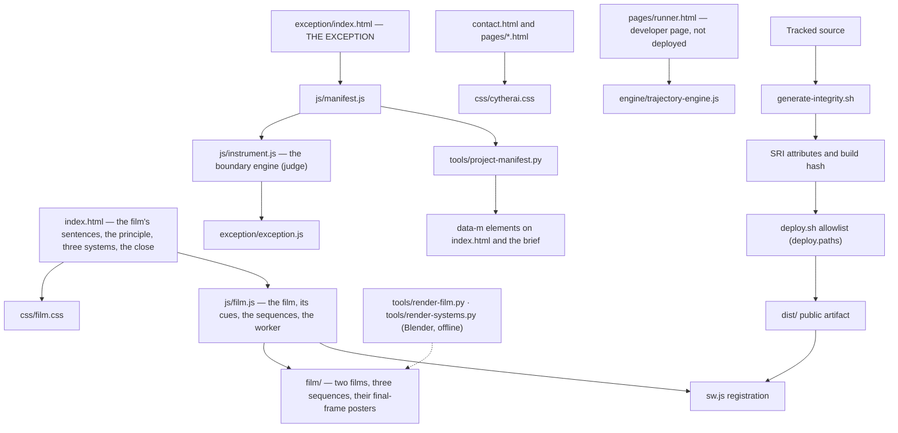

# Repository architecture

This guide describes the current tree, the runtime data flow, and the files that
must move together when the site changes. The repository is a zero-dependency
static site: source HTML, CSS, and JavaScript are served directly. There is no
framework, package graph, bundle, or server application.

The homepage is **the film** (since 2026-10-12): a twelve-second film, rendered offline and
silent, with its sentences as HTML over it, then one principle and three systems, each a
six-second sequence in the film's materials with a headline, two sentences a shipped page
states and one route into its evidence, then the invitation. Its predecessors are retired
whole, each a verbatim snapshot with every verifier that established its laws and its own
`verify.sh`: **THE UNHAPPENED** to `backup/unhappened-v1/` (commit `f5c1e37`; this guide as
it stood for it is `git show f5c1e37:docs/architecture.md`), **the drawing set** to
`backup/drawing-set-v1/` (commit `99b167a`) and **instrument-v1** to `backup/instrument-v1/`
(commit `bf82377`). Each is superseded as presentation and preserved as historical record;
nothing of their design is carried into the front door.

## System map



The front door loads one stylesheet and one deferred script, both with SRI; `js/film.js`
reads no module and publishes nothing. THE EXCEPTION loads the two record modules, which
communicate through explicit `window` APIs; load order is a contract there. The public
surface is an inventory (`tools/test-api.py`): every symbol is declared as production (called
by another served file) or verifier (used by a tool), and a symbol with no caller fails.

| Module | Public API | Loaded by | Responsibility |
|---|---|---|---|
| `js/film.js` | — | `index.html` | The film (source by orientation, cues, `still()`, `GUARD`), the sequences' IntersectionObserver, `sw.js` registration and `take-over`; DOM wiring behind `typeof document` |
| `js/manifest.js` | `CytherManifest` | `exception/` | The public manifest: `fnv` (THE EXCEPTION); `project` (the `data-m` facts, for the projector), `MANIFEST`, `VALIDATION`, `CANON`, `ADMISSION_NONCE`, `CHECKSUM` for the verifiers and the derived assets (`tools/canon.py`) |
| `js/instrument.js` | `CytherInstrument` | `exception/` | The boundary engine: `judge` (THE EXCEPTION); `biEngine` and `audit` for the verifiers. Pure, DOM-free; `tools/test-boundary.js` pins the seed-02 stream |

## Directory and ownership map

| Path | Role | Public artifact? | Change rule |
|---|---|---|---|
| `index.html` | The film's sentences, the principle, the three systems and the close | Yes | Every HTML byte moves the build identity: re-stamp after any edit; the invalid rate and its baseline are projector-owned (`data-m`) |
| `css/film.css`, `js/film.js` | The front door's style and its one script | Yes | Hashed (SRI); a change requires `./generate-integrity.sh` and re-stamping; reading ink over the film is a browser observation (CY-SEM-003) |
| `film/` | The two films, the three sequences, their final-frame posters | Yes | Rendered by `tools/render-film.py` and `tools/render-systems.py`; every file the page names ships and every shipped file is named (`tools/test-site.py`) |
| `js/manifest.js`, `js/instrument.js` | The record and the boundary engine | Yes | THE EXCEPTION's; a change requires SRI and re-stamping |
| `prototype/` | Homepage design studies, THE UNHAPPENED v1–v4 and the comparison harness | No | Design record; production does not load from it |
| `css/cytherai.css` | Shared subpage style system | Yes | Hashed; its ink law is `tools/test-site.py` |
| `contact.html` | Contact surface with the repository's one inline form script | Yes | Preserve the explicit `mailto:`/no-backend semantics unless hosting changes |
| `pages/` | Brief and legal pages; `runner.html` is a developer page | Content pages only | Content pages share navigation and CSS; `runner.html` is linked from no page, not in `deploy.paths`, not precached, unstamped |
| `engine/` | Trajectory engine and its browser suite | No | Run locally through `pages/runner.html`; not part of the homepage dependency graph or the artifact |
| `assets/` | Promoted deterministic images and icons | Selected files | Record provenance in `docs/asset-promotion-log.md`; add to `deploy.paths`; precache only if offline-critical |
| `tools/` | Generators, the film's Blender render scripts and zero-dependency test programs | No | Generators must reproduce committed bytes; tests must fail nonzero; a new harness file is added to `IDENTITY_COVERAGE` |
| `vaic/` | The VAIC-0 obligation corpus (`v3`, superseding `v2` and through it `v1` and `v0`, all kept as history), evaluator matrix, evidence ledger, release dispositions | No | Receipts append; admitted receipts are immutable across every lineage (`tools/test-vaic.py`) |
| `docs/` | Deployment contract, audit record (00–08, all instrument-v1), asset provenance, architecture | No | Evidence and operational instructions, never origin content |
| `newC3/` | Frozen design/prototype record and public demo preimage | No | Supersede; do not rewrite or deploy |
| `backup/` | Retired surfaces: `instrument-v1/`, `drawing-set-v1/` and `unhappened-v1/` (whole, with verifiers), `graphite-v2/`, `dossier-v3/`, `trajectory-engine/`, `drawing-set-demo.html`, and the uncurated project pages (`project-pages/`) | No | Historical record only; retire here, never delete, never deploy, never import from |
| `adii/` | ADII project page: the replay, its poster and fonts (shared with the homepage), the team's CVs | The reviewed set | Every URL its first publication served stays served; a new file ships only once named in `REVIEWED_PUBLICATION` (`tools/test-site.py`) |
| `awc-os/` | AWC-OS evaluation gateway (curated), its films and deck | The reviewed set | As `adii/`; `awc-os/live/` redirects to an ephemeral tunnel, is gitignored, and never ships; the gateway states no deployment claim the record does not support |
| `dist/` | Generated allowlisted release artifact | Generated | Rebuilt destructively by `deploy.sh`; never hand-edit |

## Homepage boot and steady state

`js/film.js` runs once the document is parsed.

1. It removes `no-js` (without the script, `.no-js` unveils the statement after 6 s, CSS). The
   statement is the `h1` and is exposed to assistive technology from the start, invisible but
   present; its links stay `visibility: hidden` until it appears. The film's text alternative is
   a `.sr` paragraph before it. The header's mark is the Cyther Seal, inline SVG, pixel-fitted at
   26 px (`tools/render-seal.py`); `tools/test-site.py` holds every inline seal to the computed one.
2. It picks the film and its poster by orientation (`film/film-landscape.mp4` or
   `film/film-portrait.mp4`) and plays it muted. Reduced motion skips straight to the still
   state with *Play the film* and downloads no film; a refused play, a media error, or no
   start within `GUARD` (3 s) does the same with *Replay*.
3. While the film plays, an 80 ms interval reads `currentTime` and shows each sentence in its
   window (`data-from`/`data-to`); the statement appears at 10.6 s. If `currentTime` stops
   advancing for `STALL` (2 s) while the page is visible (a hidden page's time does not
   count), the film gives way to the still state at once: it drops its source, so the poster
   — its final frame — stands, and a late download cannot restart it; its caption leaves
   without a fade, so it never lies under the statement.
4. At the end (`ended`) `still()` stops the interval, holds the last frame, shows the whole
   statement and Replay. The film never restarts on its own.
5. Each system's sequence gets its source when half of it first comes into view and plays
   once from its first frame; it holds its last frame, which is also its poster. Leaving
   view pauses it. Refused, not started within `GUARD`, or stopped for `STALL` while visible,
   it drops its source and rests on its poster for good (a 250 ms watch runs only while a
   sequence plays). An `AbortError` (scrolled away before it began) is not a failure.
   Reduced motion never plays them.
6. The service worker registers from the root and is asked to take over once this script
   has run; its cache name carries the build hash.

At steady state nothing runs: no frame is requested (the page never asks for one), no media
plays and no timer fires (CY-TEMP-001, `docs/deploy.md` §5i). Replay, a sequence scrolled
back into view, or a turn of the device (the source follows the orientation while still)
starts motion again.

## State and evidence boundaries

- Canonical facts come from `CytherManifest`: the two front-door figures and the brief's
  validation figures are projections, written into the pages by the projector.
- The film and the sequences are pre-rendered illustrations. The page says so under the
  film (*A conceptual visualization. It measures no product.*); no motion on the front door
  claims to correspond to a system event, and nothing on it is computed in the browser.
- Each system's sentences are ones its shipped page states, with its condition beside them
  and a route to the evidence; the film's sentences are positioning.
- The page discloses no obligation, receipt or verdict; the VAIC corpus under `vaic/` is the
  record, and a receipt for a build cannot be inside that build.

## Routes

| Route | Runtime |
|---|---|
| `/` or `/index.html` | The film: `css/film.css` and `js/film.js`, both SRI'd; media from `film/` |
| `/exception/` | THE EXCEPTION, an experiment published beside the front door (no homepage link since 2026-10-12): `js/manifest.js`, `js/instrument.js` (judge) and `exception/exception.js`, all SRI'd |
| `/contact.html` | Shared CSS plus one inline validation/copy script |
| `/pages/brief.html` | Static capability brief and promoted exhibits |
| `/pages/privacy.html` | Static privacy record |
| `/pages/security.html` | Static disclosure policy |
| `/pages/terms.html` | Static terms |
| `/404.html` | Host-configured styled error body; the host must still return status 404 |

## Integrity, deployment, and offline behavior

The release flow is fail-closed:

1. Edit source. After a manifest edit run `python3 tools/project-manifest.py`.
2. For any change to a served file (anything in `deploy.paths`), run
   `./generate-integrity.sh` (SRI over the requested resources; the 16-hex build identity
   over every `deploy.paths` byte, stamped into every HTML file and the worker cache
   name), then `python3 tools/vaic_restamp.py` once per transaction.
3. Run `./verify.sh`.
4. `./deploy.sh` deletes and rebuilds `dist/` from `deploy.paths`; it rejects a precached
   asset missing from the artifact and rejects the historical directories.
5. `./publish.sh` pushes the contents of `dist/` as the single-commit `gh-pages` branch
   GitHub Pages serves at `cytherai.com` (`CNAME`, `.nojekyll` are in the artifact). It
   refuses uncommitted served files, a HEAD not on `master`, and a failing `./verify.sh`.
   The origin contract and Pages' recorded limits are `docs/deploy.md` §1–§4, §7.

The service worker precaches the pages, the front door's script and stylesheet, the two
final-frame posters it stands on when the film cannot play (offline included), and the three
`adii/fonts/` files it draws its type with; films go to the network, never the cache. It
installs one build or
nothing (every fetch past the HTTP cache, the build stamp checked before commit), maps a
navigation to the scope root to cached `index.html`, and removes older caches on activate.
A new build's worker waits: it never takes over a page that may still be loading. Safari
checks for the update at the navigation itself, so a worker that skipped waiting answered a
returning reader's previous-build page, mid-load, with this build's modules, and the page
died of its own SRI check; Safari's script requests carry no integrity a worker could read,
and the page is not reliably among the worker's clients when it activates, so no rule inside
the worker can tell such a page apart. Instead the page decides: once its own script has
run, `js/film.js` sends `take-over` to a waiting worker, and the next load is the
new build. A page from before this rule never asks; its tab moves to the new build once no
page of the old build is open. Reproduced, and the fix verified with a negative control, in
the iOS 26.5 simulator (`docs/deploy.md` §5g).

## Verification map

```sh
./verify.sh
```

Module parsing, the public API inventory, the boundary stream, the projection laws,
page/resource integration (every film the front door names ships, and back),
SRI/build/cache identity, deployment closure, the subpage ink law, the derived-asset
receipts, and the VAIC-0 corpus (structure, retired-evidence resolution, every lineage,
fail-closed controls). The retired front doors: `backup/unhappened-v1/verify.sh`,
`backup/drawing-set-v1/verify.sh`, `backup/instrument-v1/verify.sh`.

Browser-only validation remains required for: the film as rendered at desktop and phone
widths, each sentence in its window and the still state; reading ink over the film and its
local darkening at glyph support (CY-SEM-003; seeking a film needs a server that answers byte
ranges); the settled state (no frame, media or timer once settled); reduced motion and a
refused play; zero external requests; service-worker install/update/offline; Safari/WebKit
muted inline autoplay and VoiceOver.

## Change-impact recipes

- Add or remove a front-door script or stylesheet: `index.html`, `generate-integrity.sh`
  (RESOURCES), `deploy.paths`, `sw.js`, `tools/test-api.py` (SERVED),
  `tools/test-site.py` (the script list), `IDENTITY_COVERAGE` (`grammar_hash`), and this guide.
- Re-render a film or a sequence: `blender -b -P tools/render-film.py -- <l|p> anim <dir> …`
  or `tools/render-systems.py` (usage in each script's header; the published films used 64
  samples with `TL=24`/`TL=14` landscape/portrait, the sequences 48 with `TL=10`), encode with
  `ffmpeg -framerate 24 -i <dir>/f%04d.png -c:v libx264 -preset slow -crf 23 -pix_fmt yuv420p
  -movflags +faststart <out>.mp4` and the last frame as its poster, replace the files under
  `film/`, regenerate integrity, and observe reading ink again: the ground under every caption
  has changed.
- Change the mark: never by hand. `python3 tools/render-seal.py` writes the icons;
  `python3 tools/render-seal.py svg SIZE INK GROUND` prints the inline seal for a page; record
  the digests in `docs/asset-promotion-log.md` (IMG-009) and re-render the social card.
- Add a public page: navigation links/current-page state, build-hash meta, CSP, local
  icon/manifest references, `generate-integrity.sh` (HTML_FILES), `deploy.paths`, and
  decide whether it belongs in `sw.js`.
- Add a claim to the front door: only as a shipped source states it, with its condition
  beside it and a link to the source; a figure is a `data-m` projection (add it to
  `HEADLINE` in `tools/test-projection.py`). An unsupported claim is dropped.
- Change manifest facts: review every `PROVISIONAL` marker, run the projector, regenerate
  integrity, and treat a genuine commitment as an owner-custody decision.
- Change an obligation: a new corpus version that supersedes the live one and carries every
  receipt verbatim (CARRIED_FORWARD or SUPERSEDED per row); re-stamp; never edit an
  admitted receipt.
- Retire a served file: move it whole into the declared snapshot, add it to `RETIRED`,
  remove it from `deploy.paths`; the receipts that cite it keep resolving.
